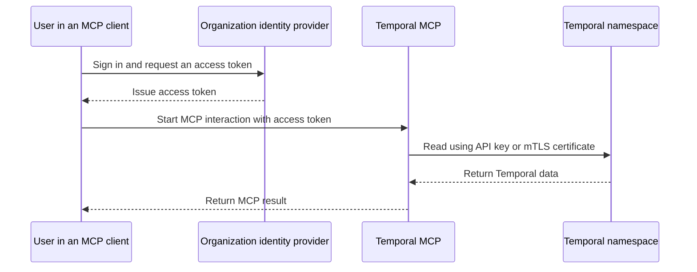

# Deploy Temporal MCP

Temporal MCP is a self-hosted gateway between MCP clients and the
Temporal namespaces named in its configuration. This guide explains the
infrastructure and security decisions required to run it. For individual YAML
fields, see the config reference.

> [!CAUTION]
>
> This project is pre-release and evolving quickly. Review the server, identity,
> and target permissions before connecting it to production namespaces.

## Deployment modes

| Mode | Who it serves | User authentication | Where Temporal credentials live | Use it for |
| --- | --- | --- | --- | --- |
| stdio | One developer | The local operating-system session | On the developer's machine | Individual evaluation and local development |
| Centrally hosted HTTPS | A team or an entire organization | OIDC access tokens from the organization's identity provider | On the server host | A centrally managed internal deployment |

Use stdio for an individual evaluation. For a centrally hosted deployment,
configure OIDC authentication and authorization and expose the MCP endpoint
only over HTTPS through the organization's approved internal access path. Do
not expose plain HTTP on the network.

Follow your coding agent's instructions for adding an MCP server. For a
centrally hosted deployment, add the HTTPS URL ending in `/mcp` and sign in. For
stdio, configure the agent to launch `temporal-mcp --stdio --config <path>`.

## Authentication

Users do not connect directly to Temporal and do not need its API key or mTLS
private key. The MCP server terminates the user connection, authorizes the tool
call, and makes the corresponding Temporal request with a target credential it
holds.

These are independent trust relationships:

1. The identity provider authenticates a user to Temporal MCP.
2. A target API key or mTLS certificate authenticates
   Temporal MCP to Temporal.

## Central deployment

1. **Install Temporal MCP.** Download the release for the server host, or build
   it from source. Run it on an internal host that can reach the Temporal
   namespaces and the identity provider. MCP clients, typically running on
   employee laptops, must be able to reach its HTTPS endpoint.
2. **Expose the MCP endpoint over HTTPS.** Choose an internal hostname and
   configure TLS in Temporal MCP or an approved colocated proxy. Do not expose
   plain HTTP on the network.
3. **Add the Temporal targets.** For each namespace, configure its address,
   namespace name, and API key or mTLS certificate. Keep file-backed credentials
   in protected paths on the host and use least-privileged credentials.
4. **Configure sign-in and access.** Add the identity provider's issuer and the
   audience for Temporal MCP. In the identity provider, expose a scope for the
   MCP API and include the chosen existing group in its access tokens. In the
   MCP config, advertise that scope and map the group claim to a profile. See
   [Identity and access](identity-and-access.md).
5. **Configure payload access.** Use `passthrough` when workflow payloads are
   readable as stored. If the application encrypts payloads with a codec,
   configure that codec and use `decode` so the MCP client can read them. Use
   `omit`, the default, only when payload contents should not be returned.
6. **Create the config and start the server.** The
   [centrally hosted OIDC and mTLS example](central-oidc-mtls.example.md) shows
   the complete YAML. Start it with `temporal-mcp --config <path>` and capture
   the audit records and error logs.
7. **Test from an MCP client.** Sign in as a user with the intended access, then
   call `list_available_targets`, `check_connection`, and one read tool.
8. **Verify access.** Confirm that users see the tools and targets assigned to
   their profiles, and review the resulting audit records.

## Access

Every successful Temporal read must pass all of these controls:

1. **The server's tool surface.** The server exposes a bounded set of read-only
   operations rather than arbitrary Temporal gRPC calls.
2. **The caller's MCP profile.** Authorization profiles grant specific tools on
   specific configured targets. A valid token that matches no rule receives no
   tools or targets.
3. **The target credential.** Temporal accepts only the operations and
   namespaces allowed to the API key or mTLS identity used for that target.
4. **The configured target boundary.** Tool calls cannot supply a different
   endpoint or use a configured target to cross into another namespace.

The identity provider supplies group membership in the access token. The MCP
YAML decides what that group can use inside this server. There is no MCP
administration UI: changing the mapping means changing the server configuration
and restarting the process.

## Changes

The server loads its overall configuration at startup. Changes to targets,
issuers, profiles, or rules require a restart.

File-backed target secrets are read on use, and TLS certificates are loaded for
new connections, so those files can be rotated without changing the YAML. The
new credentials must be accepted by the other system before the old connection
or credential stops working. Environment-backed secrets are read at startup and
require a restart to change.

## Troubleshooting

- **The user cannot sign in or receives 401 Unauthorized:** check token
  acquisition, token type, issuer, audience, expiration, and signing-key
  discovery.
- **The token is accepted but the user sees no tools:** inspect the actual
  access-token claims and compare them exactly, including case, with the
  authorization rules.
- **A tool is visible but a target is not:** confirm that the matched profile
  grants that tool on that target's configured name.
- **`check_connection` fails:** check network reachability, the target address
  and namespace, and the server-held API key or mTLS certificate. User SSO does
  not authenticate this hop.
- **Certificate rotation appears ineffective:** existing connections may still
  use the old certificate; ensure the remote service accepts the new one and
  establish a new connection.

## Verification

- The process starts with the intended config and can read every referenced
  certificate, key, and secret file.
- The HTTPS certificate is valid for the MCP hostname.
- The protected-resource metadata advertises the intended resource and
  authorization server.
- An MCP client obtains an **access token**, not an ID token, whose `iss` and
  `aud` match the server config.
- Users with different claims see exactly the intended tools and targets.
- `check_connection` succeeds for every target a user is allowed to see.
- Audit records identify the token issuer, subject, tool, target, and outcome.
- Payloads are omitted, passed through, or decoded as intended.
